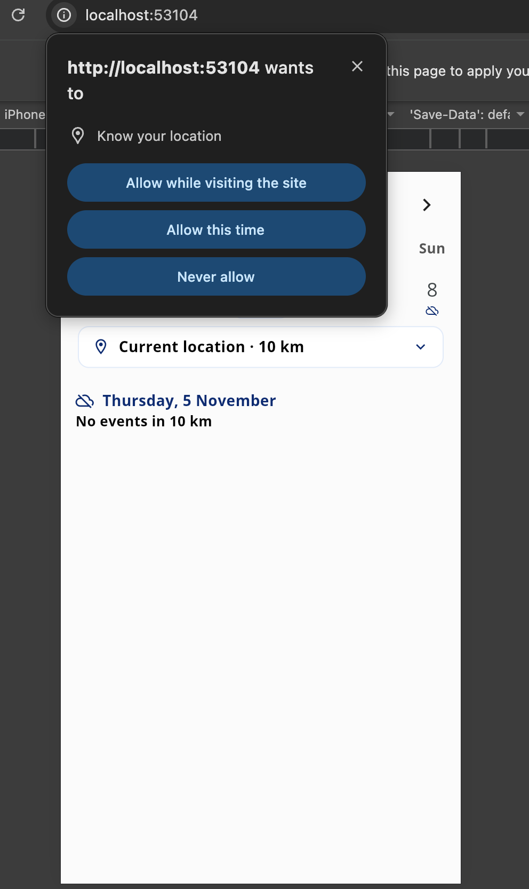
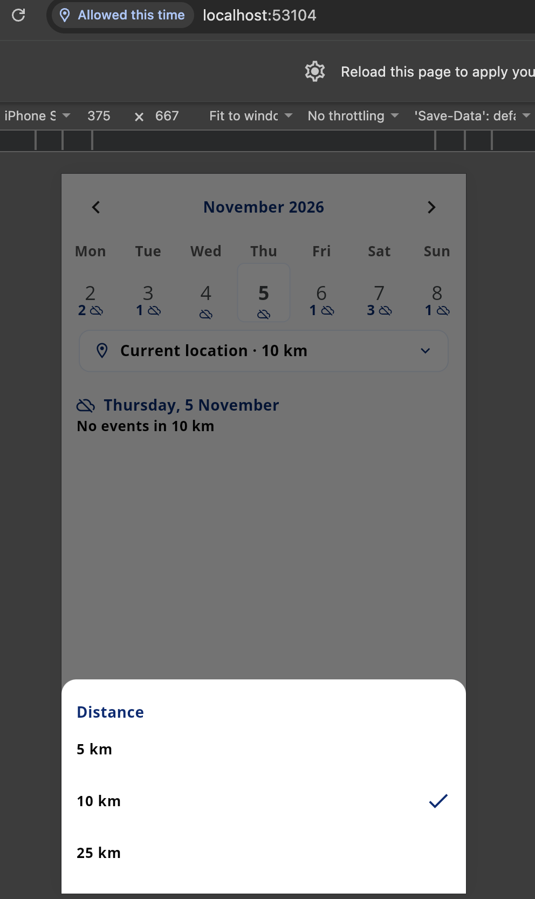
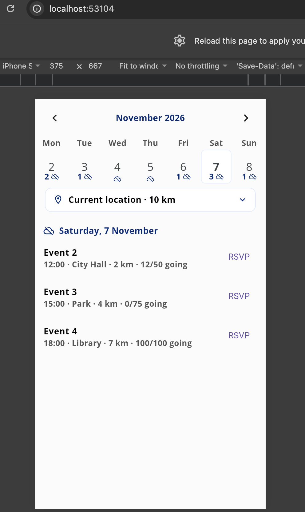
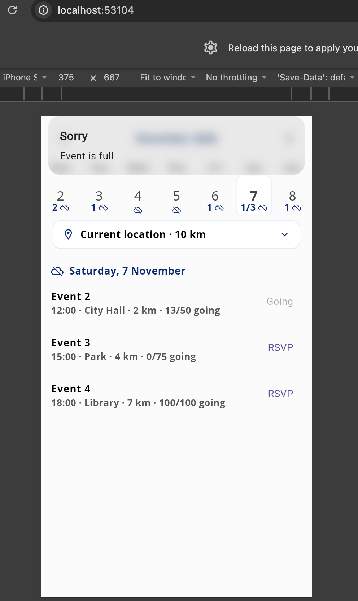
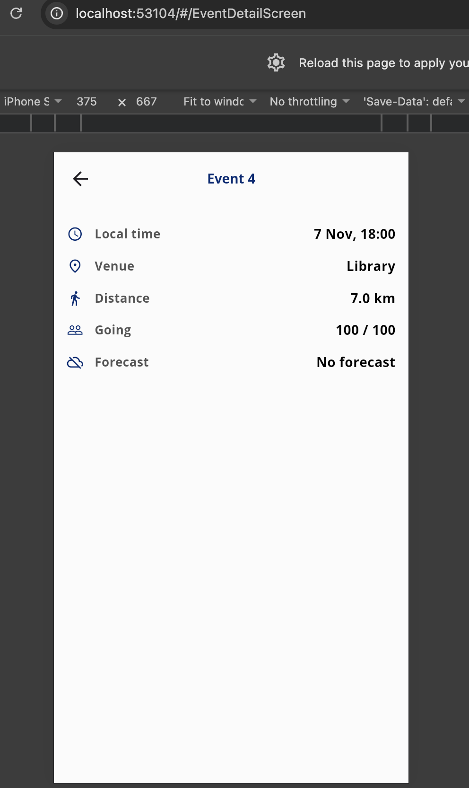

# friday_social_demo_app

Location-aware event calendar built with Flutter, GetX and clean architecture (Stage 1 of the assignment).

## What it does
- Calendar with the event count and weather icon on each day
- Tap a day to see its events
- Tap an event to see the details (time, venue, distance, going, forecast)
- Events inside 5 / 10 / 25 km of the user, or a chosen city if location is denied
- RSVP updates the screen first and goes back if the server says the event is full
- Weather comes from open-meteo, one call per month, and never blocks the events

## Screenshots

| Location permission | Distance picker | Events of a day |
|---|---|---|
|  |  |  |

| RSVP on a full event | Event detail |
|---|---|
|  |  |

## Run
```
flutter pub get
flutter run
```

## Structure
```
lib/
  core/       location, weather icons, text styles
  features/
    event/          data / domain / presentation
    event_detail/   presentation
```
